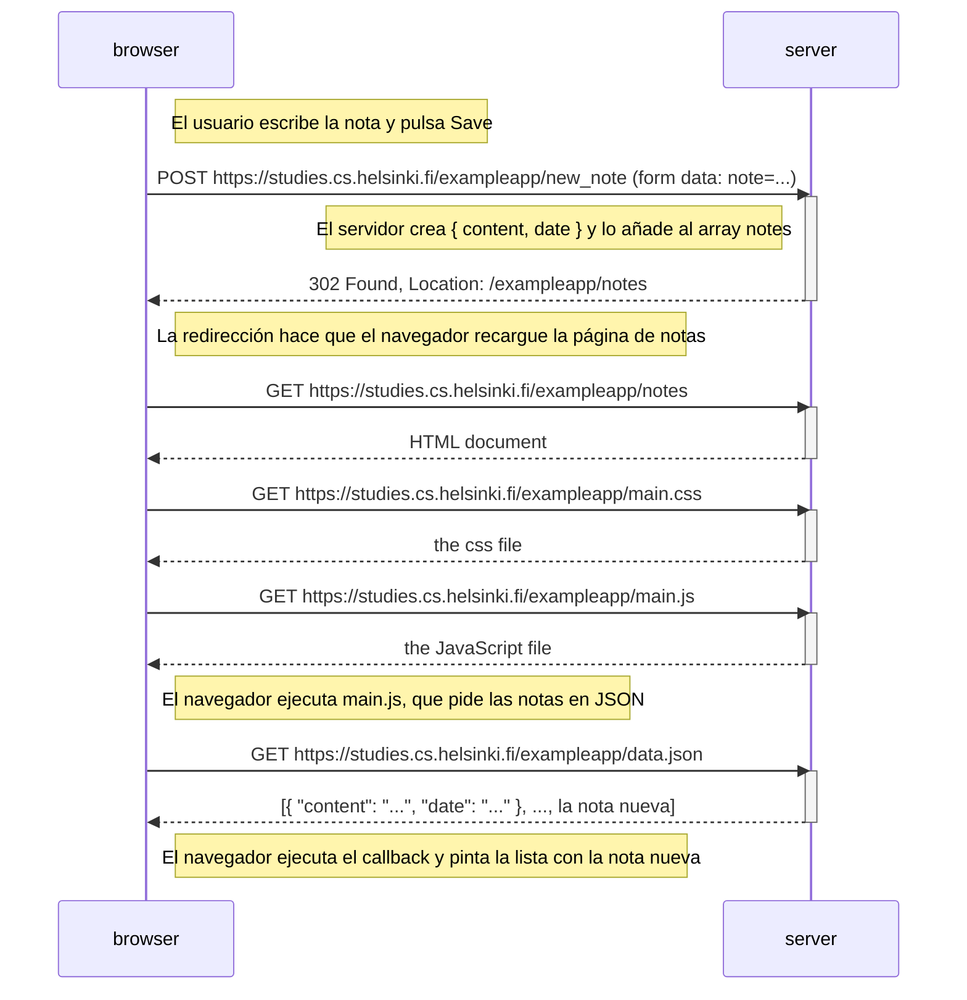

# 0.4: Nueva nota

El usuario escribe una nota en <https://studies.cs.helsinki.fi/exampleapp/notes> y pulsa *Save*. El formulario se envía de la forma tradicional y la página se vuelve a cargar entera.

