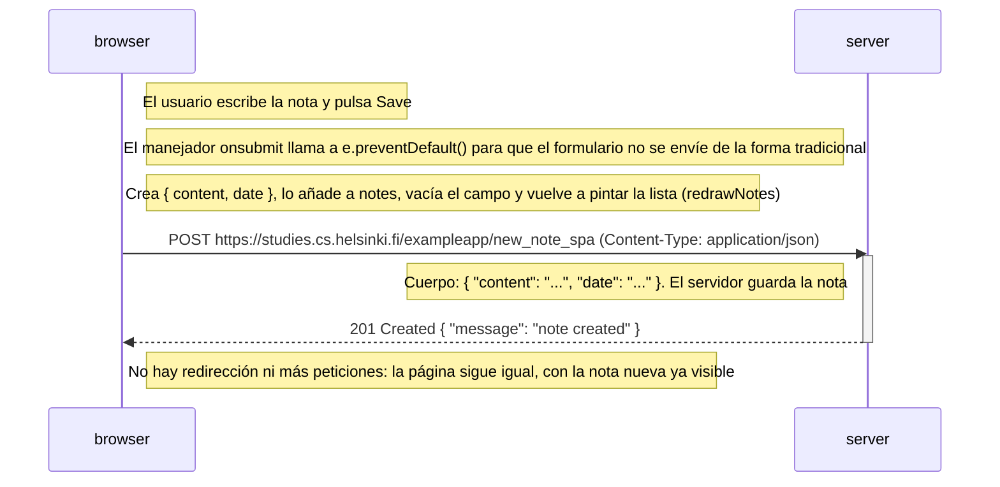

# 0.6: Nueva nota en la aplicación de una sola página

El usuario escribe una nota en la versión SPA y pulsa *Save*. La página no se recarga: el JavaScript del navegador hace todo el trabajo y solo envía una petición al servidor.

